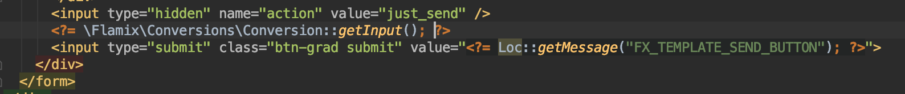

# Identifiers

The visitor's UID is read from analytics cookies, always in this order:

| Cookie | Source | Appended |
| --- | --- | --- |
| `_ym_uid` | Yandex Metrika | |
| `_ga` | Google Analytics | `\|GCLID.<id>` from the `gclid` cookie, else parsed from `_gcl_aw` |
| `_fbp` | Facebook Pixel | |
| `_ttp` | TikTok Pixel | `\|TTCLID.<id>` from the `ttclid` cookie |

`gclid` and `ttclid` arrive as URL parameters: store them in cookies first, e.g. with `\Flamix\Bitrix24\Trace::init()` from `flamix/b24-lead`.

## PHP

```php
use Flamix\Conversions\Conversion;

// _ga=GA1.2.885407728.1598192418, gclid=Cj0KCQ, _fbp=fb.1.1598192425982.77587948
Conversion::getFromCookie();
// ['_ga' => 'GA1.2.885407728.1598192418|GCLID.Cj0KCQ', '_fbp' => 'fb.1.1598192425982.77587948']

Conversion::getPreparedUID(); // 'GA1.2.885407728.1598192418|GCLID.Cj0KCQ;fb.1.1598192425982.77587948', false without cookies
```

Before a lead goes to Bitrix24:

```php
if ($uid = Conversion::getPreparedUID()) {
    $fields['UF_CRM_FX_CONVERSION'] = $uid;
}
```

## HTML

A hidden input for a form that is sent to Bitrix24 as is:

```php
echo Conversion::getInput();             // false without cookies
echo Conversion::getInput('MY_FIELD');   // another field name
```

```html
<input type='hidden' name='UF_CRM_FX_CONVERSION' value='1559040249567571161;GA1.2.885407728.1598192418;fb.1.1598192425982.77587948' />
```


